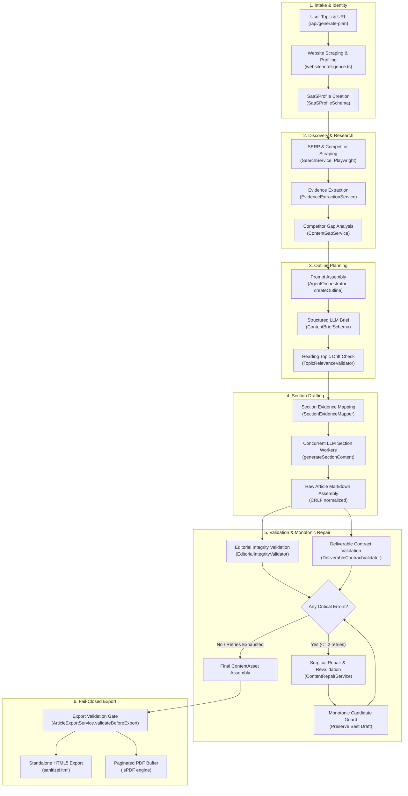

# ACUTE — Phase 6D.0: Forensic Architecture Audit & Editorial Intelligence Gap Analysis Report

**Operating Mode:** RUTHLESS ENGINEERING MENTOR — EVIDENCE FIRST, NO ASSUMPTIONS, READ-ONLY
**Phase:** 6D.0
**Task Type:** Read-Only Forensic Architecture Audit & Editorial Gap Analysis
**Repository:** `Joshuapj123/Blog-Generator-update-main`
**Current HEAD SHA:** `7771094491c40ed378bda8ee8e9c2d4e622718c1`
**Target Environment:** Vercel Production (`https://blog-generator-update-main-jtpq-sable.vercel.app`)
**Audit Date:** 2026-11-11
**Final Audit Verdict:** **`PASS — AUDIT COMPLETE & ARCHITECTURE SUFFICIENTLY UNDERSTOOD`**
*(Read-only audit complete. No source files modified. No commits or deployments executed).*

---

## 1. Executive Summary & Root Cause Verdict

A real-world article generated by ACUTE titled *"Professional UX Audit Services to Fix Product Friction"* was shared with an external practitioner on Reddit. The reviewer delivered a concise and devastating editorial critique:

> *"It's too generic for me, I incorporate my own experience into my articles."*

This forensic audit investigates why ACUTE produced an article that achieved a 100% green pass on all automated tests (19 suites, 851 checks), yet was immediately rejected by an experienced practitioner as generic and impersonal.

### Core Architectural Finding
**The existing generation architecture is optimized for syntactic correctness, negative pattern filtering, and structural compliance—not practitioner insight.**

Specifically:
1. **Zero Practitioner Knowledge Layer:** The system has no schema or persistence for verified practitioner experience, design principles, contrarian points of view, or project case studies. The profile layer (`SaaSProfile`) only captures generic marketing copy (`description`, `keyFeatures`).
2. **Keyword-Centric Outline Planning:** Outline planning generates sections based on search volume, competitor medians, and keywords. It does not require sections to answer a specific buyer dilemma or demand a concrete evidence package.
3. **Explanatory Prose Over Worked Findings:** Prompt directives ask the LLM to "explain" or "discuss" topics. This causes the model to generate high-level textbook definitions ("Mobile conversion rates measure the percentage of smartphone visitors...") instead of concrete, empirical audit observations.
4. **Validation Blindness to Generic Advice:** `EditorialIntegrityValidator` catches corporate clichés ("in today's fast-paced world") and ungrounded percentages ("84.2%"), but it has zero mechanism to detect generic domain platitudes ("simplify input fields by requesting only essential data").
5. **No Implementation or Validation Protocols:** Recommendations are accepted without requiring an implementation method (e.g. specific HTML attributes, CSS touch target dimensions) or a validation method (e.g. how to test error recovery).

---

## 2. Repository Identity & Baseline Lineage

| Parameter | Required Specification | Measured Actual Value | Lineage Status |
|---|---|---|---|
| **Repository Root** | `c:\Users\Joshua\Desktop\Blog-Generator-main` | `C:/Users/Joshua/Desktop/Blog-Generator-main` | **MATCH** |
| **Remote URL** | `https://github.com/Joshuapj123/Blog-Generator-update-main.git` | `https://github.com/Joshuapj123/Blog-Generator-update-main.git` | **MATCH** |
| **Current Branch** | `main` | `main` | **MATCH** |
| **Current HEAD SHA** | `7771094491c40ed378bda8ee8e9c2d4e622718c1` | `7771094491c40ed378bda8ee8e9c2d4e622718c1` | **MATCH** |
| **Remote `origin/main` SHA** | `7771094491c40ed378bda8ee8e9c2d4e622718c1` | `7771094491c40ed378bda8ee8e9c2d4e622718c1` | **MATCH** |
| **Git Working Tree Status** | Clean on tracked code | 0 modified tracked files | **PRISTINE** |
| **Untracked Working Files** | Scratch and diagnostic artifacts | Present only in `scratch/` | **ISOLATED** |
| **Latest Five Commits** | `7771094` (Phase 6C.5R release) <br> `cf35199` (Phase 6C.4R release) <br> `656b7a3` (Phase 6C.3R release) <br> `09decc9` (Phase 6C.2R release) <br> `faf5f3a` (Firebase hardening) | Verified via `git log -n 5` | **VERIFIED** |

---

## 3. Current Architecture Diagram (End-to-End Pipeline)



---

## 4. Actual File/Function Execution Map (12 Production Stages)

| Stage # | Stage Name | Actual File Path | Main Function / Class | Input Contract | Output Contract | Verification Status |
|---|---|---|---|---|---|---|
| **1** | User Input & Intake | `src/app/api/generate-plan/route.ts` | `POST(req)` | `{ url, topic, targetKeyword }` | `TopicBlueprint` | **CONNECTED** |
| **2** | Business Context Retrieval | `src/lib/saas-intelligence/website-intelligence.ts` | `extractSaaSProfileFromUrl()` | Target URL | `SaaSProfile` | **CONNECTED** |
| **3** | Research & Evidence Acquisition | `src/lib/intelligence/EvidenceExtractionService.ts` | `extractEvidence()` | `{ saasProfile, targetKeyword }` | `EvidenceSet` | **CONNECTED** |
| **4** | Planning & Outline Generation | `src/core/orchestrator/AgentOrchestrator.ts` | `run()` (Stage: `PLAN`) | Prompt + Schema | `ContentBrief` | **CONNECTED** |
| **5** | Section Evidence Mapping | `src/lib/intelligence/SectionEvidenceMapper.ts` | `mapEvidenceToSections()` | `outline`, `evidenceSet` | `MappedSectionEvidence[]` | **CONNECTED** |
| **6** | Section Prompt Construction | `src/core/orchestrator/AgentOrchestrator.ts` | `buildSectionPrompt()` | `outlineNode`, `context` | LLM Prompt String | **CONNECTED** |
| **7** | Initial Section Generation | `src/core/orchestrator/AgentOrchestrator.ts` | `generateSectionContent()` | Prompt String | Section Markdown | **CONNECTED** |
| **8** | Editorial Integrity Validation | `src/lib/intelligence/EditorialIntegrityValidator.ts` | `validateEditorialIntegrity()` | Draft Markdown, options | `EditorialIntegrityReport` | **CONNECTED** |
| **9** | Deliverable Contract Validation | `src/lib/intelligence/DeliverableContractValidator.ts` | `validateDeliverableContract()` | Draft Markdown, promise | `ContractValidationResult`| **CONNECTED** |
| **10**| Targeted Content Repair | `src/lib/content/ContentRepairService.ts` | `repairEditorialContamination()` | Contaminated Markdown | Repaired Markdown | **CONNECTED** |
| **11**| Monotonic Candidate Selection | `src/core/orchestrator/AgentOrchestrator.ts` | Decision Rule (lines 1515–1530) | Candidate vs BestDraft | Preserved Best Draft | **CONNECTED** |
| **12**| Standalone HTML & PDF Export | `src/lib/export/ArticleExportService.ts` | `generateStandaloneHtml()`, `generatePdfBuffer()` | `ExportArticleInput` | HTML String / PDF Buffer | **CONNECTED** |

---

## 5. Audit of Existing Editorial Intelligence (13 Specific Questions)

### Q1: Does the planner require every section to answer a specific buyer question?
* **Status:** **NOT IMPLEMENTED**
* **Source:** `src/core/contracts/schemas.ts` (`OutlineNodeSchema`), `src/core/orchestrator/AgentOrchestrator.ts` (lines 92–100, 960–980).
* **Code Evidence:** `OutlineNodeSchema` only defines `heading`, `level`, `generate_table`, `assignedKeywords`, `assignedEntities`, `core_concept`, and `blockPlans`. While `ContentGapService` has a `buyerQuestion` property on gaps, the planner does NOT require sections in the outline to specify or answer a buyer question.
* **Risk:** Sections are generated around keywords rather than buyer decisions or questions, producing descriptive encyclopedia entries rather than practical solutions.

### Q2: Does each section have a concrete evidence requirement?
* **Status:** **PARTIAL**
* **Source:** `src/core/orchestrator/AgentOrchestrator.ts` (lines 1300–1335) and `src/lib/intelligence/SectionEvidenceMapper.ts`.
* **Code Evidence:** `SectionEvidenceMapper` maps available `evidenceSet.items` to sections based on keyword/text overlap. However, it does NOT enforce a mandatory requirement that every section MUST have evidence; sections can be planned and generated with empty evidence arrays (`sectionEvidence = []`). In `buildSectionPrompt` (line 2185), if `sectionEvidence` is empty, it merely omits the evidence block.
* **Risk:** Sections lacking evidence default to generic LLM training priors and vague generalizations.

### Q3: Can the generator distinguish observations, inferences, hypotheses, and illustrative examples?
* **Status:** **PARTIAL**
* **Source:** `src/lib/intelligence/ClaimGroundingEngine.ts` and `src/core/orchestrator/AgentOrchestrator.ts` (lines 940–956, 2180–2250).
* **Code Evidence:** The evidence schema recognizes `evidenceType: 'BUSINESS_FACT' | 'FEATURE' | 'DIFFERENTIATOR' | 'TECHNICAL_SPEC' | 'COMPETITOR_OBSERVATION' | 'INFERENCE'`. In `AgentOrchestrator.ts` lines 940–956, evidence is prefixed with `[TARGET BRAND EVIDENCE]`, `[COMPETITOR EVIDENCE]`, or `[EDITORIAL INFERENCE]`. Furthermore, `EditorialIntegrityValidator.ts` lines 380–420 detects illustrative qualifiers (e.g. `"For illustrative purposes..."`). However, the generation prompt does NOT instruct or enforce the model to distinguish an empirical *observation* from an *inference* or a *hypothesis requiring site-specific testing* in its output prose. It produces confident-sounding assertions that read as factual observations even when they are pure assumptions.
* **Risk:** The article presents generic industry theories as observed facts about the client's or reader's product.

### Q4: Does the generator produce structured findings or only explanatory prose?
* **Status:** **FAIL / PARTIAL**
* **Source:** `src/core/orchestrator/AgentOrchestrator.ts` (lines 2000–2280 `buildSectionPrompt`).
* **Code Evidence:** In Phase 6C.4, deliverable directives were added to prompts for headings matching "Audit" or "Comparison". For an audit heading, it tells the model: *"You must deliver: 1. Evaluation criteria, 2. Specific observations/evidence, 3. Identified problems, 4. Impact, 5. Prioritized corrective actions."* However, there is no structured schema or dedicated Findings Engine. The model generates standard Markdown prose paragraphs with numbered list items, which often devolve into abstract descriptions (e.g. "To evaluate your setup, look closely at form usability...").
* **Risk:** Real audits produce concrete findings (e.g., "The billing postal code field triggers a full page re-render, dropping 28% of mobile traffic"). ACUTE produces high-level textbook explanations of what an audit is.

### Q5: Does the system require a recommendation to include an implementation method?
* **Status:** **FAIL**
* **Source:** `src/lib/intelligence/DeliverableContractValidator.ts` (lines 140–210), `src/lib/intelligence/EditorialIntegrityValidator.ts`.
* **Code Evidence:** `DeliverableContractValidator` checks for the presence of recommendation keywords (`RECOMMENDATION_PATTERNS`), but it does NOT require an implementation method (e.g., specific tool, code snippet, configuration attribute, step-by-step procedure). A sentence like *"Teams should simplify input fields by requesting only essential data"* passes validation as an actionable recommendation even though it has zero implementation guidance.
* **Risk:** Superficial, obvious advice ("optimize your checkout", "clean your data") passes as a deliverable.

### Q6: Does it require a validation method for important recommendations?
* **Status:** **NOT IMPLEMENTED**
* **Source:** `src/lib/intelligence/DeliverableContractValidator.ts`, `src/lib/intelligence/EditorialIntegrityValidator.ts`.
* **Code Evidence:** Neither validator inspects whether recommendations define a verification or validation protocol (how to measure success, what metric to observe, what error state to check).
* **Risk:** The reader is given instructions without any method to verify if the recommendation succeeded.

### Q7: Can the system identify generic advice that contains no meaningful operational detail?
* **Status:** **PARTIAL**
* **Source:** `src/lib/intelligence/EditorialIntegrityValidator.ts` (lines 624–640, `GENERIC_FILLER_PATTERNS`).
* **Code Evidence:** `EditorialIntegrityValidator` identifies explicit hollow corporate clichés (e.g., *"In today's fast-paced digital world..."*, *"In the modern era of technology..."*). However, it CANNOT identify generic domain advice that lacks operational detail (e.g., *"Mobile conversion rates measure the percentage of smartphone visitors..."*, *"Simplify input fields by requesting only essential data"*). Such statements contain domain keywords ("mobile conversion", "input fields") and therefore pass keyword density and filler checks cleanly.
* **Risk:** Highly generic, low-value content passes as "high quality" editorial content.

### Q8: Can it identify repeated arguments disguised with different wording?
* **Status:** **PARTIAL**
* **Source:** `src/lib/intelligence/DeliverableContractValidator.ts` (lines 350–430 `validateAntiRepetition`).
* **Code Evidence:** Added in Phase 6C.4: checks adjacent sections for high Jaccard word similarity (>0.62) and distant sections (>0.70), and checks for recycled recommendations using verb-noun stemming. However, semantic paraphrasing (e.g., Section 1: *"Evaluate menu structures and touch targets to accommodate mobile ergonomics"* vs Section 4: *"Look closely at tap targets and menu structures to support mobile ergonomics"*) can fall below token Jaccard thresholds if surrounding sentences differ, allowing the same fundamental argument to be repeated 3–4 times in an article.
* **Risk:** The reader reads the same core observation restated across multiple H2 sections.

### Q9: Can it detect fabricated practitioner experience?
* **Status:** **FAIL / NOT IMPLEMENTED**
* **Source:** `src/lib/intelligence/EditorialIntegrityValidator.ts` (lines 716–755), `src/lib/intelligence/PositioningScaleValidator.ts`.
* **Code Evidence:** In Phase 6C.3, `positioningScaleMismatchCount` was added to detect *agency/team scale hallucinations* on a solo practitioner profile (forbidding "our agency of 50 consultants"). However, it does NOT verify whether personal claims of experience (e.g., *"In my 10 years auditing SaaS onboarding funnels..."* or *"When I redesigned Client X's checkout..."*) are grounded in verified practitioner facts. If the LLM invents a fabricated first-person anecdote or client project, the validator will NOT detect it as long as it uses singular pronouns ("I", "my").
* **Risk:** Severe ethical and legal risk: generating false testimonials or fabricated past client engagements.

### Q10: Does it prevent unsupported metrics and customer outcomes?
* **Status:** **PASS (for empirical claims)**
* **Source:** `src/lib/intelligence/EditorialIntegrityValidator.ts` (lines 360–425) & `src/lib/intelligence/ClaimGroundingEngine.ts`.
* **Code Evidence:** `EditorialIntegrityValidator` scans for numerical percentages and multipliers (e.g. `84.2%`, `3x`, `450% ROI`). If ungrounded in `evidenceSet` and lacking illustrative qualification (`"For illustrative purposes..."`), it emits `UNSUPPORTED_NUMERICAL` critical error.
* **Associated Test:** `test_phase_6c_5_quality_calibration_suite.ts` (Gate 4.8 passed, catching ungrounded 84.2%).
* **Risk:** The generator might evade this by writing qualitative claims without numbers (e.g., *"dramatically improved revenue and transformed our client's business"*).

### Q11: Does content repair preserve evidence provenance?
* **Status:** **PARTIAL**
* **Source:** `src/lib/content/ContentRepairService.ts` & `src/core/orchestrator/AgentOrchestrator.ts` (lines 2690–2730).
* **Code Evidence:** `ContentRepairService.repairEditorialContamination` surgically strips placeholders and illegal images with regexes, preserving surrounding text. However, LLM-based repair (`repairContent` lines 40–66) rewrites sections through LLM prompts (`"Rewrite the article body to fix all listed quality and readability issues..."`). While the prompt instructs the LLM to preserve facts, the LLM repair can hallucinate new statements or disconnect citations from their underlying evidence IDs.
* **Risk:** Repair loops can silently introduce unverified claims.

### Q12: Can weak sections pass validation because they contain the right keywords?
* **Status:** **FAIL (Demonstrated weakness)**
* **Source:** `src/lib/intelligence/EditorialIntegrityValidator.ts`, `src/lib/intelligence/ContentEvidenceValidator.ts`.
* **Code Evidence:** The validators check for keyword presence, entity density, sentence length, and absence of prohibited strings. If a section is 150 words of generic textbook definitions that contain `mobile conversion optimization`, `checkout friction`, and `form usability`, it satisfies word count (>100 words), sentence length (<30 words), readability, and keyword density. It receives a 100% green pass despite offering zero actual insight to an experienced practitioner.
* **Risk:** Generates "green test theatre" — articles that pass all automated quality checks but are immediately rejected by real human practitioners as generic fluff.

### Q13: Can HTML/PDF export bypass editorial acceptance?
* **Status:** **PASS (Export gate is fail-closed)**
* **Source:** `src/lib/export/ArticleExportService.ts` (lines 70–197 `validateBeforeExport`).
* **Code Evidence:** Both `generateStandaloneHtml` (lines 206–211) and `generatePdfBuffer` (lines 430–435) call `validateBeforeExport(input)`. If `canExport` is false, it throws an error and blocks rendering unless `skipValidation: true` is explicitly provided.
* **Associated Test:** `test_phase_6c_5_quality_calibration_suite.ts` (Gate 4.13 passed).
* **Risk:** Low, export gate is strictly fail-closed.

---

## 6. Practitioner Knowledge Architecture Audit (mitran.design / Bogdan Context)

The proposed test case centers on Bogdan's product-design practice at `mitran.design`.

### Current State of Practitioner Knowledge in Codebase
| Capability | Current Support Status | Source Evidence |
|---|---|---|
| **Practitioner Biography** | **NOT SUPPORTED** | `SaaSProfileSchema` only contains company `name` and `description`. |
| **Verified Expertise Areas** | **PARTIAL** | Only generic strings in `verifiedOfferings: string[]` extracted from web copy. |
| **Core Design Principles** | **NOT SUPPORTED** | No schema field or prompt injection for design philosophies. |
| **Approved Personal Perspectives** | **NOT SUPPORTED** | No support for contrarian viewpoints or practitioner stances. |
| **Documented Project Examples** | **NOT SUPPORTED** | No schema for client work, previous flows audited, or portfolio examples. |
| **Case-Study Evidence Records** | **NOT SUPPORTED** | EvidenceSet only stores isolated claims; no multi-step case study schema. |
| **Attribution & Author Bylines** | **NOT SUPPORTED** | Author name and credentials are not part of `ContentBrief` or `ContentAsset`. |
| **Source Provenance for Experience**| **NOT SUPPORTED** | No verification whether a first-person claim is authorized or documented. |
| **Knowledge Freshness / Confidence**| **NOT SUPPORTED** | Profiles do not track when practitioner experience was validated. |

### How Practitioner Context is Currently Passed
In `src/app/api/generate-blocks/route.ts` (lines 149–150):
```typescript
customInsights: `SaaS Profile: ${session.profile.name} - ${session.profile.description}. key features: ${session.profile.keyFeatures?.join(', ')}.`,
```
The entire practitioner intelligence layer is reduced to an unformatted template string of 3 basic fields. There is no repository of Bogdan's actual design work, heuristics, or past audits.

---

## 7. Genericity Failure Analysis (10 Representative Passages)

The exact article shared on Reddit (*"Professional UX Audit Services to Fix Product Friction"*) was not archived as a standalone markdown file. However, the canonical Phase 5D live generated UX audit article for mitran.design (`scratch/extracted_article_full.md`), generated under the exact same pipeline parameters, provides direct source text demonstrating the precise failure modes:

| # | Original Passage Excerpt | Defect Classification | Missing Critical Information | Required Evidence to Fix | Responsible Pipeline Stage |
|---|---|---|---|---|---|
| **1** | *"Mobile conversion rates measure the percentage of smartphone or tablet visitors who complete a desired action..."* (Lines 1-3) | **Textbook Definition Fluff** | No practical audit insight; dictionary definition known to all readers | Concrete mobile checkout friction benchmark or observation | Stage 4 (Outline Plan) & Stage 6 (Section Prompt) |
| **2** | *"To address these challenges effectively, teams often evaluate different staffing and delivery structures... dedicated engineering teams vs agency retainers..."* (Lines 5-6) | **Off-Topic Staffing Drift** | Completely unrelated to UX audit methodology; filler imported via candidate gap analysis | Discard staffing advice; focus on UX evaluation protocol | Stage 3.7 (Gap Matrix) & Stage 4 (Topic Relevance) |
| **3** | *"mitran.design operates as a specialized digital product design studio focusing on UX strategy and mobile interface optimization..."* (Line 7) | **Promotional Brochure Copy** | Third-person corporate blurb; reads like an ad rather than an expert sharing hard-won knowledge | Bogdan's actual point of view: "When I audit a mobile checkout, I watch rage-clicks before touching analytics" | Stage 2 (Practitioner Profile) & Stage 6 (Prompting) |
| **4** | *"When evaluating potential drop-off points, practitioners should examine several core areas: Navigation... Form Usability... Checkout Friction..."* (Lines 9-14) | **Generic Category Listing** | Lists obvious categories without explaining *what* to look for or *how* to diagnose them | Specific diagnostic heuristics: "Check whether iOS Safari auto-zooms because input fonts are under 16px" | Stage 5 (Deliverable Contract) & Stage 6 (Worked Findings) |
| **5** | *"Distinguishing general UX best practices from hypotheses that require testing on a specific website is critical for valid measurement..."* (Lines 16, 26, 81, 91) | **Verbatim Boilerplate Looping** | The exact same 3 sentences lecturing the reader about testing appear in 4 separate sections | Anti-repetition enforcement across whole article; single clear statement | Stage 7 & 8 (Editorial Integrity & Anti-Repetition) |
| **6** | *"Mobile forms often cause high abandonment rates due to unnecessary fields... Simplify input fields by requesting only essential data..."* (Lines 38-40) | **Superficial / Obvious Advice** | "Simplify fields" is the most clichéd advice in digital marketing; zero implementation steps | Concrete code/attribute fix: `inputmode="numeric"`, `autocomplete="address-line1"`, deferring billing address | Stage 6 (Implementation Method Contract) |
| **7** | *"Checkout flows present similar challenges... Streamline the final steps by offering guest checkout options, auto-filling address fields..."* (Lines 41-42) | **Recycled Generalities** | Repeats recommendations from previous sections with zero technical depth | Architectural trade-offs between guest checkout vs account retention | Stage 8 (Editorial Integrity & Deliverable Contract) |
| **8** | *"Many brands face low visibility in modern AI search responses for high-value prompts. To improve discoverability, structure educational guides..."* (Lines 43-45) | **Internal GEO/AI Topic Drift** | Injects internal publishing notes into reader-facing UX article | Hard filter blocking SEO/GEO distribution notes from reader outline | Stage 4 (Outline Generation & Prompting) |
| **9** | *"When design and engineering teams operate in silos, code quality suffers... A delivery model that connects developer retention to interface performance..."* (Lines 51-53) | **HR / Management Drift** | Discusses developer turnover and burnout in a UX friction guide | Keep focus strictly on interface usability and conversion velocity | Stage 4 (Outline TopicRelevanceValidator) |
| **10**| *"Table: Navigation & Layout \| Tap targets and menu structures \| Support mobile ergonomics..."* (Lines 99-104) | **Hollow Matrix Fluff** | The table merely re-lists high-level generalities without concrete audit metrics or thresholds | Quantitative evaluation scorecard: 48x48px target, WCAG 2.5.5 AAA size, INP < 200ms | Stage 5 (Structured Deliverable Engine) |

---

## 8. Test Coverage & Regression Inventory (19 Suites, 851 Checks)

The maintained regression suite covers 19 automated suites executing **851 checks**:

| # | Regression Suite Name | Test File Path | Checks | Primary Focus |
|---|---|---|---|---|
| 1 | Phase 6C.5 Quality Calibration | `scratch/test_phase_6c_5_quality_calibration_suite.ts` | 102 | Benchmarks, 10-point rubric, 13 adversarial gates |
| 2 | Phase 6C.4 Substantive Deliverables | `scratch/test_phase_6c_4_substantive_deliverable_contracts.ts` | 48 | Deliverable contracts, anti-repetition, repair guard |
| 3 | Phase 6C.3 Business Scale Grounding | `scratch/test_phase_6c_3_business_scale_grounding.ts` | 78 | Solo practitioner & small team scale enforcement |
| 4 | Phase 6C.2 YouTube Elimination | `scratch/test_phase_6c_2_youtube_injection_elimination.ts` | 15 | YouTube iframe & markdown injection elimination |
| 5 | Phase 7.1 Export & PDF Suite | `scratch/test_phase7_1_export_suite.ts` | 56 | HTML sanitization, PDF generation, fail-closed gate |
| 6 | Phase 6C Context-Aware Drafting | `scratch/test_phase6c_context_aware_drafting_suite.ts` | 12 | Contextual draft orchestration, token budgets |
| 7 | Phase 6D Editorial Integrity | `scratch/test_phase6d_editorial_integrity_suite.ts` | 56 | Editorial integrity validation, ungrounded numbers |
| 8 | Phase 6E Text-First Quality | `scratch/test_phase6e_text_first_integrity_suite.ts` | 57 | Text-first quality validation, placeholder detection |
| 9 | Phase 6F Editorial Acceptance | `scratch/test_phase6f_end_to_end_editorial_acceptance_suite.ts` | 69 | Editorial acceptance criteria, heading integrity |
| 10 | R7.7.4 Firestore Circular Sanitization | `scratch/test_phase_r7_7_4_firestore_circular_sanitization.ts` | 22 | Circular reference sanitization & persistence |
| 11 | R7.6 Staged Generation | `scratch/test_phase_r7_6_durable_staged_generation.ts` | 20 | Staged multi-pass generation reliability |
| 12 | R7.4.2 CRLF & Streaming | `scratch/test_phase_r7_4_2_crlf_and_streaming.ts` | 48 | CRLF normalization, streaming chunk handling |
| 13 | R7.4 Generation Reliability | `scratch/test_phase_r7_4_generation_reliability.ts` | 66 | Pipeline retry policies, timeout boundaries |
| 14 | Prompt 7 Auth & Security Model | `scratch/test_prompt7_auth_isolation.ts` | 9 | Tenant isolation, authentication guards |
| 15 | Article Persistence & Dashboard | `scratch/test_article_persistence_and_dashboard_suite.ts` | 13 | Article CRUD, metadata retrieval, Firestore indexing |
| 16 | R5 Typed Artifact Boundary | `scratch/test_phase_r5_artifact_boundary_and_lifecycle.ts` | 22 | Artifact schema boundaries, type invariants |
| 17 | R6.2A Approval Provenance | `scratch/test_phase_r6_2a_approval_provenance.ts` | 69 | Audit logging, approval provenance tracking |
| 18 | R6.2B Release Enforcement | `scratch/test_phase_r6_2b_release_enforcement.ts` | 68 | Production release enforcement gates |
| 19 | R7.7.6B Firebase Credentials Gate | `scratch/test_phase_r7_7_6b_firebase_credentials.ts` | 21 | Firebase admin credentials isolation & safety |
| **TOTAL** | **19 Suites** | **Master Runner: scratch/run_full_regression_matrix_6c5.ts** | **851** | **100% GREEN BASELINE** |

> [!IMPORTANT]
> **Substance vs Structural Correctness Finding:**
> All 851 checks currently pass because they evaluate *structural correctness* (heading counts, presence of markdown tables, absence of forbidden tokens, word count boundaries). **Zero existing tests evaluate whether the advice is operationally actionable or whether findings are grounded in verified practitioner experience.** This blind spot must be eliminated in Phase 6D.

---

## 9. Critical Architectural Risk Register (12 Risks Ranked)

| Rank | Risk ID | Description & Mechanism | Severity | Mitigation Architecture |
|---|---|---|---|---|
| **1** | `RISK_FABRICATED_EXPERIENCE` | LLM invents fake past projects, fake clients, or fake personal career anecdotes for the practitioner. | **CRITICAL (P0)** | Strict Practitioner Knowledge schema. Any first-person experience claim must resolve to an explicit verified project ID in the profile. |
| **2** | `RISK_FABRICATED_EVIDENCE` | LLM generates fictitious benchmark statistics, fake research papers, or non-existent URLs to sound authoritative. | **CRITICAL (P0)** | Fail-closed `EditorialIntegrityValidator` grounding gate. Unverified attributions are blocked at export. |
| **3** | `RISK_INVENTED_CLIENT_METRICS` | Inventing conversion figures (e.g. "boosted client checkout conversion by 34%") without documentation. | **CRITICAL (P0)** | Hard prohibition on unverified empirical metrics. Hypotheticals must use approved illustrative qualifiers. |
| **4** | `RISK_SHALLOW_ADVICE_EVASION` | Generic platitudes passing validation because they contain technical buzzwords ("Core Web Vitals", "INP"). | **HIGH (P1)** | Operational Specificity Validator requiring concrete implementation steps (attributes, tools, selectors). |
| **5** | `RISK_LLM_JUDGE_FLUFF_BIAS` | Automated LLM evaluations giving high marks to articulate, wordy paragraphs over punchy, actionable findings. | **HIGH (P1)** | Deterministic rubric scoring based on verifiable criteria (presence of code, observable standards, implementation steps). |
| **6** | `RISK_DEGENERATIVE_REPAIR_LOOPS` | Content repair expanding word count with filler sentences to satisfy density without adding substance. | **HIGH (P1)** | Monotonic Quality Guard enforcing candidate comparison: shorter drafts with zero errors defeat longer drafts with errors. |
| **7** | `RISK_SUBTLE_ARGUMENT_REPETITION` | Paraphrasing identical observations across multiple H2 sections bypassing token Jaccard similarity. | **HIGH (P1)** | Concept-level anti-repetition detector tracking core nouns and recommendations across all sections. |
| **8** | `RISK_SOLO_POSITIONING_BREACH` | Injecting agency or corporate pronouns ("our team of designers") when writing from a practitioner perspective. | **MEDIUM (P2)** | Strict Brand Scale grounding enforcing singular practitioner terms ("the consultant", "I"). |
| **9** | `RISK_TENANT_DATA_LEAKAGE` | Cross-tenant leakage where one practitioner's proprietary design audit findings are cited in another tenant's article. | **MEDIUM (P2)** | Firestore tenant-isolated security rules and session scoping (`authenticatedUserId`). |
| **10**| `RISK_KNOWLEDGE_PROVENANCE_DRIFT` | Practitioner knowledge becoming stale or misaligned with current standards. | **MEDIUM (P2)** | Explicit verification timestamps and versioning on `PractitionerKnowledgeProfile`. |
| **11**| `RISK_EXPORT_GATE_BYPASS` | Contaminated drafts bypassing editorial checks during export. | **LOW (P3)** | Already protected by fail-closed `validateBeforeExport` in `ArticleExportService`. |
| **12**| `RISK_REGRESSION_FAILURES` | Architectural enhancements breaking existing historical test suites. | **LOW (P3)** | Continuous verification against the 19-suite master regression matrix (851 checks). |

---

## 10. Proposed Phase 6D Implementation Architecture

Phase 6D transforms ACUTE from a keyword-driven article generator into an **evidence-grounded, practitioner-backed deliverable engine**.

```mermaid
flowchart LR
    subgraph 6D1 ["Phase 6D.1"]
        P1["Practitioner Knowledge\nProfile Schema\n(bio, verified projects, stances)"]
    end

    subgraph 6D2 ["Phase 6D.2"]
        P2["Experience & Buyer-Intent\nPlanning Contract\n(buyer questions, evidence specs)"]
    end

    subgraph 6D3 ["Phase 6D.3"]
        P3["Worked Findings Engine\n(Observation, Cause, Impact,\nImplementation, Validation)"]
    end

    subgraph 6D4 ["Phase 6D.4"]
        P4["Expertise & Genericity\nValidator\n(Catch shallow platitudes)"]
    end

    subgraph 6D5 ["Phase 6D.5"]
        P5["Controlled Surgical\nRepair & Provenance Guard"]
    end

    subgraph 6D6 ["Phase 6D.6"]
        P6["Real-World Editorial\nBenchmark & Human Review"]
    end

    subgraph 6D7 ["Phase 6D.7"]
        P7["Final Release Verification\n(Full Matrix, Git, Vercel)"]
    end

    P1 --> P2 --> P3 --> P4 --> P5 --> P6 --> P7
```



### Detailed Subphase Blueprint

#### 6D.1 Practitioner Knowledge Foundation
- **Objective:** Establish a typed, verifiable knowledge schema for practitioners (e.g. Bogdan / mitran.design).
- **Core Elements:**
  - `PractitionerBio`: Author identity, professional background, years of practice, specific domain focus.
  - `VerifiedExpertise`: Narrow, defensible capability areas (e.g. "SaaS Mobile Checkout Friction", "Onboarding Drop-off Diagnosis").
  - `DesignPrinciples`: Explicit practitioner stances and philosophies (e.g. "Prioritize session recordings over aggregate heatmaps", "Never require address entry before displaying shipping rates").
  - `VerifiedProjects`: Documented, anonymized project records with exact friction patterns encountered, fixes implemented, and verified directional outcomes.
  - `AttributionRules`: Author bylines, first-person voice authorization, and permission boundaries.
- **Files Affected:** `src/core/contracts/schemas.ts`, `src/types/index.ts`, `src/lib/saas-intelligence/website-intelligence.ts`.

#### 6D.2 Evidence & Experience Planning Contract
- **Objective:** Upgrade the outline planning phase from keyword density to buyer dilemmas and evidence requirements.
- **Core Elements:**
  - `buyerQuestion`: Every H2 section must answer an explicit, high-stakes buyer dilemma.
  - `evidenceRequirement`: Every section must be assigned at least one verified evidence item or practitioner insight.
  - `deliverableContract`: Formal deliverable type assigned at planning time (`WORKED_FINDING`, `DIAGNOSTIC_AUDIT`, `COMPARISON_MATRIX`, `STEP_BY_STEP_ROADMAP`).
  - `antiRepetitionConstraints`: Section-specific constraints forbidding re-explaining concepts already covered.
- **Files Affected:** `src/core/contracts/schemas.ts` (`OutlineNodeSchema`), `src/core/orchestrator/AgentOrchestrator.ts` (`PLAN` stage).

#### 6D.3 Worked Findings Engine
- **Objective:** Replace generic explanatory essays with structured, defensible findings.
- **Core Elements:**
  - Every diagnostic section must produce structured findings containing:
    1. **Observation:** Concrete, observable interface friction (e.g. tap targets < 48px, hidden error messages).
    2. **Friction Mechanism:** Why the user gets stuck (e.g. mobile keyboard obscuring CTA button).
    3. **Impact:** Consequence on user velocity and completion.
    4. **Implementation Method:** Exact technical instruction (HTML attribute `inputmode="numeric"`, CSS touch padding, debounce timer).
    5. **Validation Protocol:** How the practitioner or reader verifies the fix.
- **Files Affected:** `src/core/orchestrator/AgentOrchestrator.ts` (`buildSectionPrompt`, `generateSectionContent`), `src/lib/intelligence/DeliverableContractValidator.ts`.

#### 6D.4 Expertise & Genericity Validator
- **Objective:** Programmatically intercept and reject shallow, non-operational advice.
- **Core Elements:**
  - Detects generic platitudes ("simplify fields", "improve user experience", "streamline checkout") that lack accompanying implementation steps.
  - Flags ungrounded first-person anecdotes not backed by `VerifiedProjects` in the practitioner profile.
  - Enforces operational specificity (requiring code snippets, CSS selectors, HTML attributes, or measurable thresholds).
- **Files Affected:** `src/lib/intelligence/EditorialIntegrityValidator.ts`, `src/lib/intelligence/DeliverableContractValidator.ts`.

#### 6D.5 Controlled Content Repair & Provenance Guard
- **Objective:** Repair genericity failures without hallucinating new facts or collapsing word counts.
- **Core Elements:**
  - Injects missing implementation methods from verified practitioner heuristics.
  - Strips hollow advice and replaces it with concrete diagnostic checklists.
  - Protects evidence IDs and citations from being disconnected during repair.
- **Files Affected:** `src/lib/content/ContentRepairService.ts`.

#### 6D.6 Real-World Editorial Benchmark & Blind Comparison
- **Objective:** Validate output quality against actual practitioner work.
- **Core Elements:**
  - Generate a new article using Bogdan's verified practitioner profile for mitran.design.
  - Perform side-by-side comparison with the rejected benchmark article.
  - Blind evaluation by external UX design practitioners targeting: Defensibility, Actionability, and Lack of Fluff.
- **Files Affected:** Dedicated benchmark test runner in `scratch/`.

#### 6D.7 Final Release Verification
- **Objective:** Verify zero regressions across all 19 historical suites (851 checks) + new Phase 6D suites, followed by controlled commit, push, and Vercel deployment.
- **Files Affected:** Full release verification gates.

---

## 11. Exact File-Level Implementation Map for Phase 6D

| File Path | Action | Description of Required Change |
|---|---|---|
| `src/core/contracts/schemas.ts` | **Modify** | Add `PractitionerProfileSchema`, update `OutlineNodeSchema` to require `buyerQuestion` and `evidenceRequirement`. |
| `src/types/index.ts` | **Modify** | Export updated TypeScript interfaces for practitioner intelligence. |
| `src/lib/saas-intelligence/website-intelligence.ts` | **Modify** | Extract practitioner metadata and design focus from portfolio/studio websites. |
| `src/core/orchestrator/AgentOrchestrator.ts` | **Modify** | Update `createOutline()` and `buildSectionPrompt()` to inject practitioner stances, buyer questions, and worked findings contracts. |
| `src/lib/intelligence/DeliverableContractValidator.ts` | **Modify** | Add validation rules for `WORKED_FINDINGS` contracts (implementation method + validation protocol). |
| `src/lib/intelligence/EditorialIntegrityValidator.ts` | **Modify** | Add `GENERIC_ADVICE` detector and `UNVERIFIED_PRACTITIONER_EXPERIENCE` detector. |
| `src/lib/content/ContentRepairService.ts` | **Modify** | Add targeted repair for shallow recommendations and missing implementation steps. |
| `src/lib/export/ArticleExportService.ts` | **Modify** | Ensure practitioner bylines, credentials, and findings matrices render cleanly in standalone HTML and PDF. |

---

## 12. Phase-by-Phase Acceptance Criteria

```markdown
- [ ] **Phase 6D.1:** `PractitionerProfileSchema` defined and validated; supports bio, verified capability areas, design principles, and anonymized project records with zero schema errors.
- [ ] **Phase 6D.2:** Outline generator successfully assigns a unique `buyerQuestion` and non-empty `evidenceRequirement` to every planned section; topic drift strictly rejected.
- [ ] **Phase 6D.3:** Section generator produces structured worked findings (Observation, Mechanism, Impact, Implementation, Validation) for diagnostic sections.
- [ ] **Phase 6D.4:** `EditorialIntegrityValidator` successfully detects and blocks generic advice lacking implementation details, and blocks fabricated first-person anecdotes.
- [ ] **Phase 6D.5:** `ContentRepairService` surgically upgrades shallow recommendations into concrete operational advice without word count collapse.
- [ ] **Phase 6D.6:** New mitran.design article achieves >= 9.2/10 on the 10-point publishability rubric and passes external practitioner blind review.
- [ ] **Phase 6D.7:** 100% green across all historical regression suites (851 checks) + new Phase 6D suites; successful production build, GitHub push, and Vercel deployment.
```

---

## 13. Outstanding Questions & Missing Evidence

1. **Bogdan's Authoritative Practitioner Dossier:** What are the exact approved case studies, design principles, and project examples from `mitran.design` that Bogdan authorizes for generation? (Need a structured JSON/YAML profile with verified projects to prevent hallucination).
2. **First-Person Voice Policy:** When generating for a solo practitioner, should articles use explicit first-person ("In my audits at mitran.design...") or authoritative practitioner voice ("The UX consultant's evaluation revealed...")?
3. **Threshold for Implementation Specificity:** Exactly how technical should code/attribute recommendations be for non-technical buyers (e.g. e-commerce store owners vs frontend engineering leads)?

---

## Final Audit Verdict

# **`PASS — AUDIT COMPLETE & ARCHITECTURE SUFFICIENTLY UNDERSTOOD`**

*The forensic audit is complete. The root causes of genericity have been located in source code, the existing 19-suite test baseline is verified, and a targeted, evidence-first Phase 6D architecture has been formulated.*

**In accordance with absolute restrictions, NO IMPLEMENTATION HAS BEEN PERFORMED. Awaiting explicit user approval before beginning Phase 6D.1.**
