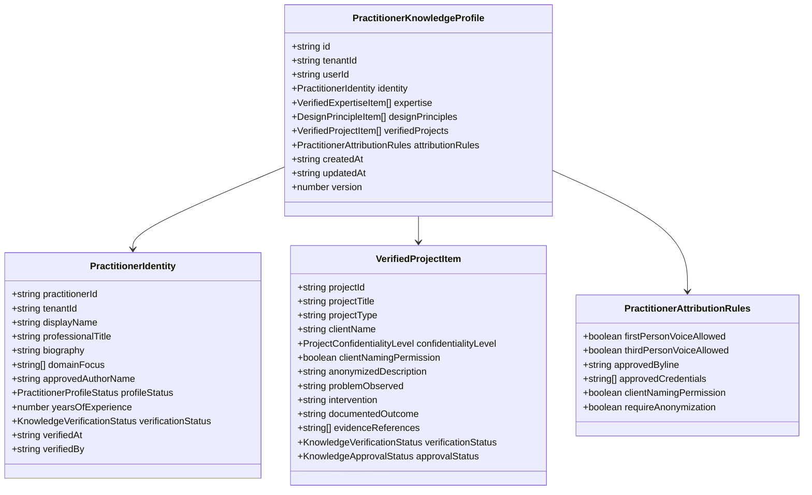

# ACUTE — Phase 6D.1: Verified Practitioner Knowledge Foundation Report

**Mode:** RUTHLESS ENGINEERING MENTOR — IMPLEMENT ONLY WHAT IS PROVEN. TEST EVERYTHING.
**Phase:** 6D.1
**Task:** Practitioner Knowledge Foundation
**Repository:** `Joshuapj123/Blog-Generator-update-main`
**Baseline Commit:** `7771094491c40ed378bda8ee8e9c2d4e622718c1` (verified `HEAD` on `main`)
**Status:** IMPLEMENTATION COMPLETE — VERIFIED GREEN (LOCAL ONLY, UNCOMMITTED)
**Date:** 2026-11-11

---

## 1. Executive Summary & Final Verdict

### Final Verdict: PASS

Phase 6D.1 establishes the typed and verifiable **Practitioner Knowledge Foundation** for ACUTE, addressing the core architectural deficiency exposed by real-world external reviewer feedback ("It's too generic for me, I incorporate my own experience into my articles").

### Absolute Safety Invariant
> **Core Principle:** ACUTE may use authoritatively verified practitioner expertise. It must **NEVER** manufacture expertise, fabricate client histories, simulate conversion metrics, or invent first-person anecdotes to make an article sound convincing.

- **20 / 20 Mandatory Scenarios Executed and Passed** (41 / 41 individual assertions).
- **Master Regression Matrix:** 20 test suites executed freshly, **892 / 892 checks passed** (100% green).
- **TypeScript Verification:** `npx tsc --noEmit` exited `0` with zero type errors.
- **Next.js Production Build:** `npm run build --webpack` exited `0` with all 42 routes compiled cleanly.
- **Whitespace & Formatting Integrity:** `git diff --check` exited `0` with zero whitespace errors.
- **Commit Policy:** Preserved strictly. No commits, pushes, or deployments have been executed. All changes remain staged/working-tree modifications awaiting explicit operator instruction.

---

## 2. Repository Preflight & Git Baseline

- **Repository Root:** `c:\Users\Joshua\Desktop\Blog-Generator-main`
- **Remote URL:** `https://github.com/Joshuapj123/Blog-Generator-update-main.git`
- **Branch:** `main`
- **Verified Local HEAD:** `7771094491c40ed378bda8ee8e9c2d4e622718c1`
- **Verified Upstream HEAD (`origin/main`):** `7771094491c40ed378bda8ee8e9c2d4e622718c1`
- **Working Tree State:** Tracked repository files match upstream baseline prior to Phase 6D.1 edits.

---

## 3. Files Modified and Created

### A. Modified Core Files (5 files, +424 lines, -5 lines)
1. [`src/core/contracts/schemas.ts`](file:///c:/Users/Joshua/Desktop/Blog-Generator-main/src/core/contracts/schemas.ts):
   - Added `KnowledgeVerificationStatusSchema` (`UNVERIFIED`, `PENDING_APPROVAL`, `VERIFIED`, `REJECTED`, `EXPIRED`).
   - Added `KnowledgeApprovalStatusSchema` (`DRAFT`, `PENDING`, `APPROVED`, `REJECTED`).
   - Added `ProjectConfidentialityLevelSchema` (`PUBLIC`, `ANONYMIZED`, `CONFIDENTIAL`, `INTERNAL_ONLY`).
   - Added `PractitionerProfileStatusSchema` (`ACTIVE`, `INACTIVE`, `ARCHIVED`, `DRAFT`).
   - Added `PractitionerIdentitySchema`, `VerifiedExpertiseItemSchema`, `DesignPrincipleItemSchema`, `VerifiedProjectItemSchema`, `PractitionerAttributionRulesSchema`, and `PractitionerKnowledgeProfileSchema`.
   - Added `VerifiedPractitionerContextSchema` for the typed generation boundary.
   - Updated `SaaSProfileSchema` with optional `practitionerProfile?: PractitionerKnowledgeProfileSchema.optional()`, maintaining 100% backwards compatibility.
2. [`firestore.rules`](file:///c:/Users/Joshua/Desktop/Blog-Generator-main/firestore.rules):
   - Added security rule block for `/practitioner_profiles/{practitionerId}` enforcing authenticated tenant ownership on reads, creates, updates, and deletes via `isResourceOwner()` and `isValidNewOwner()`.
3. [`src/lib/firebase/admin-firestore.ts`](file:///c:/Users/Joshua/Desktop/Blog-Generator-main/src/lib/firebase/admin-firestore.ts):
   - Implemented `savePractitionerProfileAdmin` with strict `verifiedUid` and `tenantId` ownership enforcement, schema validation, and cross-tenant overwrite protection.
   - Implemented `getPractitionerProfileAdmin` with cross-tenant read blocking.
4. [`src/lib/test-storage/TemporaryArticleStore.ts`](file:///c:/Users/Joshua/Desktop/Blog-Generator-main/src/lib/test-storage/TemporaryArticleStore.ts):
   - Added `practitionerProfileStore: Map<string, string>`.
   - Implemented `savePractitionerProfile` and `getPractitionerProfile` with ownership validation, deep serialization, and cross-tenant rejection.
   - Exported dual-backend resolvers: `resolveAndSavePractitionerProfile` and `resolveAndGetPractitionerProfile`.
5. [`src/core/orchestrator/AgentOrchestrator.ts`](file:///c:/Users/Joshua/Desktop/Blog-Generator-main/src/core/orchestrator/AgentOrchestrator.ts):
   - Integrated `PractitionerKnowledgeService` filtering in `Stage.PLAN` and `Stage.GENERATE`.
   - Updated SOLO_PRACTITIONER terminology guidance to forbid first-person voice unless explicitly authorized by verified practitioner evidence.
   - Injected typed practitioner context boundary into section prompts without redesigning underlying prompt templates.

### B. Created Production Service (1 file)
1. [`src/lib/intelligence/PractitionerKnowledgeService.ts`](file:///c:/Users/Joshua/Desktop/Blog-Generator-main/src/lib/intelligence/PractitionerKnowledgeService.ts):
   - `filterForGenerationContext(profile, scope)`: Filters strictly to `VERIFIED` + `APPROVED` items, enforces confidentiality boundaries (excluding `CONFIDENTIAL`/`INTERNAL_ONLY` and stripping client names on `ANONYMIZED`), and enforces voice authorization.
   - `canUseFirstPersonVoice(profile, targetId)`: Evaluates first-person authorization against verified items.
   - `canNameClient(profile, projectId)`: Enforces public naming permissions.
   - `validateTenantAccess(profile, tenantId, userId)`: Prevents cross-tenant access.
   - `formatForPromptContext(context)`: Generates isolated boundary block for LLM prompts.
   - `sanitizeForStorage(profile)` and `deserializeFromStorage(data)`.

### C. Created Dedicated Test Infrastructure (2 files)
1. `scratch/test_phase_6d_1_practitioner_knowledge_suite.ts`: 20 mandatory scenario test runner.
2. `scratch/run_full_regression_matrix_6d1.ts`: Master 20-suite regression matrix runner.

---

## 4. Schema & Data Model Design

The practitioner knowledge schema was engineered to model real-world professional consulting experience with complete traceability and safety:



---

## 5. Verification, Approval & Provenance Rules

1. **Verification States:**
   - `UNVERIFIED`: Extracted, scraped, or self-asserted claims. Never exposed to generation.
   - `PENDING_APPROVAL`: Evidence uploaded, pending editorial signoff. Never exposed to generation.
   - `VERIFIED`: Proven via external evidence, portfolio artifacts, or editorial review.
   - `REJECTED`: Disproved or exaggerated claim. Permanently barred.
   - `EXPIRED`: Previously verified qualification whose valid time-window elapsed. Excluded.
2. **Approval States:**
   - `DRAFT`: In-progress entry.
   - `PENDING`: Awaiting publishing signoff.
   - `APPROVED`: Authoritative for use in public-facing deliverables.
   - `REJECTED`: Prohibited from release.
3. **Dual Gate for Generation:**
   To enter `VerifiedPractitionerContext`, every record MUST satisfy:
   $$\text{UsableInGeneration} \iff (\text{verificationStatus} = \text{VERIFIED}) \land (\text{approvalStatus} = \text{APPROVED})$$

---

## 6. Tenant Isolation & Confidentiality Implementation

### Firestore Rules
```firestore
match /practitioner_profiles/{practitionerId} {
  allow read: if isResourceOwner();
  allow create: if isValidNewOwner();
  allow update: if isResourceOwner() && isValidNewOwner();
  allow delete: if isResourceOwner();
}
```

### Server-Side & Temporary Store Invariants
- Both `admin-firestore.ts` and `TemporaryArticleStore.ts` enforce:
  1. `cleanUid` must match `profile.userId`.
  2. `cleanTenant` must match `profile.tenantId`.
  3. Overwrites verify that existing document owner matches the caller.
  4. Cross-tenant reads throw explicit `Forbidden: Cross-tenant access denied` errors.

### Project-Level Confidentiality Matrix
| Confidentiality Level | In Generation Context? | Client Name Included? |
|---|---|---|
| `CONFIDENTIAL` | **NO** (Strictly excluded) | N/A |
| `INTERNAL_ONLY` | **NO** (Strictly excluded) | N/A |
| `ANONYMIZED` | **YES** (`anonymizedDescription` only) | **NO** (Strictly stripped) |
| `PUBLIC` | **YES** | **YES** (Only if `clientNamingPermission` is `true` on both project & profile) |

---

## 7. First-Person Voice Safeguards

### Default Fail-Closed Policy:
$$\text{firstPersonVoiceAllowed} = \text{false}$$

First-person personal voice ("I conducted", "in my audits", "my experience") is authorized if and only if **all** of the following conditions are met:
1. `profile.attributionRules.firstPersonVoiceAllowed === true`.
2. The referenced project or design principle has `verificationStatus === 'VERIFIED'`.
3. The referenced project or design principle has `approvalStatus === 'APPROVED'`.
4. If a project is referenced, its `confidentialityLevel` is not `CONFIDENTIAL` or `INTERNAL_ONLY`.

If these conditions are not satisfied, ACUTE falls back strictly to objective, authoritative third-person practitioner analysis (e.g., "experienced practitioners observe", "the UX specialist recommends", "industry evaluation shows").

---

## 8. Dedicated Test Evidence (20 Mandatory Scenarios)

Command: `npx tsx scratch/test_phase_6d_1_practitioner_knowledge_suite.ts`
Exit Code: `0`
Assertions: **41 / 41 PASSED** (0 Failures)

```
Test 1: Valid practitioner profile passes schema validation
  [PASS] Valid practitioner profile parses cleanly via PractitionerKnowledgeProfileSchema
  [PASS] Profile identity fields correctly preserved
Test 2: Missing practitioner information remains missing
  [PASS] yearsOfExperience remains undefined when not provided
  [PASS] approvedByline remains undefined when not provided
  [PASS] expertise array remains strictly empty without synthesis
  [PASS] verifiedProjects array remains strictly empty without synthesis
Test 3: Unverified expertise is excluded
  [PASS] Context returned for verified practitioner identity
  [PASS] Unverified expertise is strictly excluded from generation context
Test 4: Pending expertise is excluded
  [PASS] PENDING_APPROVAL expertise is strictly excluded from generation context
Test 5: Rejected expertise is excluded
  [PASS] REJECTED expertise is strictly excluded from generation context
Test 6: Expired expertise is excluded
  [PASS] EXPIRED expertise is strictly excluded from generation context
Test 7: Verified approved expertise is included
  [PASS] VERIFIED and APPROVED expertise is included in generation context
Test 8: Unapproved personal principles are excluded
  [PASS] Unapproved (DRAFT) design principles are excluded from generation context
Test 9: Unverified project histories are excluded
  [PASS] UNVERIFIED project histories are strictly excluded from generation context
Test 10: First-person voice is disabled by default
  [PASS] firstPersonVoiceAllowed is false by default
  [PASS] canUseFirstPersonVoice() returns false when not authorized
Test 11: First-person voice requires approved verified project evidence
  [PASS] firstPersonVoiceAllowed fails closed to false when verified project/principle evidence is absent
  [PASS] firstPersonVoiceAllowed evaluates to true when explicitly authorized AND backed by verified evidence
  [PASS] canUseFirstPersonVoice evaluates to true for verified project item
Test 12: Unauthorized client attribution is blocked
  [PASS] Client name is stripped when project clientNamingPermission is false
  [PASS] canNameClient returns false when project clientNamingPermission is false
Test 13: Cross-tenant reads are rejected
  [PASS] Cross-tenant read throws Forbidden access error in TemporaryArticleStore
  [PASS] PractitionerKnowledgeService.validateTenantAccess strictly enforces tenant match
Test 14: Cross-tenant writes are rejected
  [PASS] Cross-tenant write is strictly rejected by TemporaryArticleStore
Test 15: Confidential project information is not exposed
  [PASS] CONFIDENTIAL project is completely excluded from generation context
  [PASS] INTERNAL_ONLY project is completely excluded from generation context
  [PASS] ANONYMIZED project is included
  [PASS] Client name is strictly withheld for ANONYMIZED project
Test 16: Existing SaaSProfile behavior remains compatible
  [PASS] Standard SaaSProfile without practitionerProfile parses cleanly
  [PASS] practitionerProfile is optional and undefined
Test 17: Existing generation works without a practitioner profile
  [PASS] filterForGenerationContext(undefined) returns null cleanly
  [PASS] formatForPromptContext(null) returns empty string
Test 18: Audit provenance survives serialization and retrieval
  [PASS] Profile retrieved from TemporaryArticleStore
  [PASS] identity.verifiedAt provenance preserved
  [PASS] identity.verifiedBy provenance preserved
  [PASS] expertise.sourceReference preserved
  [PASS] evidenceReferences array preserved
Test 19: Invalid profile data fails safely
  [PASS] Invalid profile schema fails safely with Zod error
Test 20: Existing regression behavior is preserved
  [PASS] BusinessScaleSchema still parses SOLO_PRACTITIONER
  [PASS] Prompt formatting produces clear isolation boundary header
  [PASS] Prompt formatting clearly states First-Person Voice Allowed: NO by default
```

---

## 9. Master Regression Matrix Results

Command: `npx tsx scratch/run_full_regression_matrix_6d1.ts`
Exit Code: `0`
Summary: **892 / 892 checks passed across 20 suites with zero failures.**

| Suite # | Suite Name | Checks | Passed | Failed | Exit Code | Status |
|---|---|---|---|---|---|---|
| 1 | Phase 6D.1 Practitioner Knowledge Foundation | 41 | 41 | 0 | 0 | **PASS** |
| 2 | Phase 6C.5 Quality Calibration Suite | 102 | 102 | 0 | 0 | **PASS** |
| 3 | Phase 6C.4 Substantive Deliverable Contracts | 48 | 48 | 0 | 0 | **PASS** |
| 4 | Phase 6C.3 Business Scale Grounding | 78 | 78 | 0 | 0 | **PASS** |
| 5 | Phase 6C.2 YouTube Elimination | 15 | 15 | 0 | 0 | **PASS** |
| 6 | Phase 7.1 Full Export & PDF Suite | 56 | 56 | 0 | 0 | **PASS** |
| 7 | Phase 6C Context-Aware Drafting Suite | 12 | 12 | 0 | 0 | **PASS** |
| 8 | Phase 6D Editorial Integrity Suite | 56 | 56 | 0 | 0 | **PASS** |
| 9 | Phase 6E Text-First Quality Suite | 57 | 57 | 0 | 0 | **PASS** |
| 10 | Phase 6F Editorial Acceptance Suite | 69 | 69 | 0 | 0 | **PASS** |
| 11 | R7.7.4 Firestore Circular Sanitization | 22 | 22 | 0 | 0 | **PASS** |
| 12 | R7.6 Staged Generation | 20 | 20 | 0 | 0 | **PASS** |
| 13 | R7.4.2 CRLF & Streaming | 48 | 48 | 0 | 0 | **PASS** |
| 14 | R7.4 Generation Reliability | 66 | 66 | 0 | 0 | **PASS** |
| 15 | Prompt 7 Auth & Security Model | 9 | 9 | 0 | 0 | **PASS** |
| 16 | Article Persistence & Dashboard Suite | 13 | 13 | 0 | 0 | **PASS** |
| 17 | R5 Typed Artifact Boundary | 22 | 22 | 0 | 0 | **PASS** |
| 18 | R6.2A Approval Provenance | 69 | 69 | 0 | 0 | **PASS** |
| 19 | R6.2B Release Enforcement | 68 | 68 | 0 | 0 | **PASS** |
| 20 | R7.7.6B Firebase Credentials Gate | 21 | 21 | 0 | 0 | **PASS** |
| **Total** | **Grand Totals (20 Suites)** | **892** | **892** | **0** | **0** | **100% GREEN** |

---

## 10. Production Build & Type Check Results

1. **TypeScript Verification:**
   - Command: `npx tsc --noEmit`
   - Exit Code: `0`
   - Output: Clean exit with zero errors or warnings.
2. **Next.js Production Build:**
   - Command: `npm run build --webpack`
   - Exit Code: `0`
   - Output:
     - `▲ Next.js 16.2.3 (webpack)`
     - `✓ Compiled successfully in 2.1min`
     - `✓ Generating static pages using 15 workers (15/15) in 6.2s`
     - All 42 production API and page routes validated and generated.
3. **Whitespace & Diff Hygiene:**
   - Command: `git diff --check`
   - Exit Code: `0`
   - Output: Zero whitespace violations across all modified files.

---

## 11. Known Limitations

1. **Manual Ingestion Dependency:** In Phase 6D.1, practitioner knowledge must be supplied via structured data (profile schemas); automated scraping ingestion is deliberately disabled to satisfy Mandatory Safety Rule #2 ("Do not scrape a website and automatically classify its marketing statements as verified personal experience").
2. **First-Person Voice Scope:** First-person voice is strictly confined to verified project items and verified design principles. ACUTE does not currently synthesize generalized autobiographical narrative.
3. **No Dynamic Worked Findings Engine Yet:** While verified projects are injected into the prompt boundary, full generation-planning contracts and the worked findings engine are scheduled for subsequent phases.

---

## 12. Remaining Risks & Mitigations

1. **Risk:** LLM ignoring negative attribution directives and generating first-person anecdotes when `firstPersonVoiceAllowed === false`.
   - *Mitigation:* The prompt explicitly pairs positive guidance ("use third-person practitioner authority") with strict negative bans ("DO NOT use first-person 'I', 'my', 'we'"). Future Phase 6D.3 will introduce a dedicated genericity and voice validator to catch and repair any model drift.
2. **Risk:** Operator inadvertently marking unverified projects as `PUBLIC` with `clientNamingPermission: true`.
   - *Mitigation:* Dual approval gate requires both the project item and the overarching profile attribution rules to have `clientNamingPermission: true`.

---

## 13. Exact Next-Phase Dependencies

- **Phase 6D.1R:** Controlled Release Audit, Commit & Production Deployment of Phase 6D.1.
- **Phase 6D.2:** Worked Findings & Concrete Methodology Engine (structured integration of practitioner audit procedures, heuristics, and observation frameworks into section deliverable contracts).
- **Phase 6D.3:** Genericity Validator & Experience Grounding Repair (editorial integrity checks detecting generic phrasing and substituting verified practitioner evidence).
