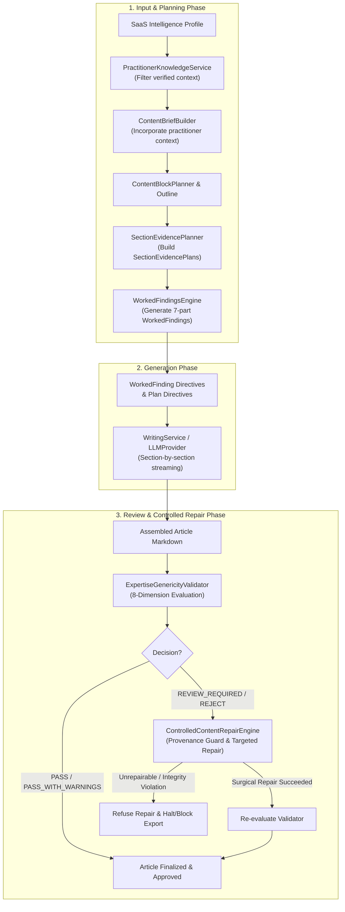

# ACUTE — Phase 6D.6: Forensic Baseline Report

**Operating Mode:** RUTHLESS MENTOR — FAST EXECUTION, EVIDENCE FIRST, ZERO PRODUCTION RISK
**Phase:** 6D.6 — Real-World Editorial Benchmark
**Date:** 2026-11-22
**Repository:** `https://github.com/Joshuapj123/Blog-Generator-update-main.git`
**Base Commit SHA:** `6cd59dd8589160fbe903d71d1c2b81da85550ea8`
**Dedicated Feature Branch:** `feature/phase-6d-6-editorial-benchmark`
**Production Main Baseline:** `7771094491c40ed378bda8ee8e9c2d4e622718c1`
**Vercel Preview Deployment Baseline:** `dpl_DvXTjYXBbqnWz3Zsv6K2x2rxc47k` (`● Ready`)

---

## 1. Executive Baseline & Mission

Phase 6D.6 establishes an **independent, real-world editorial benchmark** for ACUTE.

Over Phases 6D.1 through 6D.5, ACUTE has constructed a comprehensive stack of content intelligence and governance:
1. **Phase 6D.1:** Practitioner Knowledge Foundation (`PractitionerKnowledgeService.ts`) — verified claims, authorization boundaries, first-person voice restrictions, tenant isolation.
2. **Phase 6D.2:** Section Evidence Planning Contract (`SectionEvidencePlanner.ts`) — structural planning connecting evidence items to outline sections.
3. **Phase 6D.3:** Evidence-Grounded Worked Findings Engine (`WorkedFindingsEngine.ts`) — 7-part worked finding generation (Observation, Evidence, Rationale, Impact, Recommendation, Implementation Steps, Validation Method).
4. **Phase 6D.4:** Expertise & Genericity Validator (`ExpertiseGenericityValidator.ts`) — multi-dimensional detection of shallow reasoning, generic advice, ungrounded metrics, citation hallucination, and formatting anti-patterns.
5. **Phase 6D.5:** Controlled Content Repair Engine & Provenance Guard (`ControlledContentRepairEngine.ts`) — surgical repair with strict non-fabrication rules, rollback on score regression, and provenance preservation.

The mission of Phase 6D.6 is to evaluate whether ACUTE delivers genuinely useful, substantive, practitioner-grade SEO content under realistic, external-style conditions, avoiding both self-referential validation leakage and superficial scoring artifacts.

---

## 2. Git & Repository Forensics

```bash
git remote -v
# origin  https://github.com/Joshuapj123/Blog-Generator-update-main.git (fetch)
# origin  https://github.com/Joshuapj123/Blog-Generator-update-main.git (push)

git branch --show-current
# feature/phase-6d-6-editorial-benchmark

git rev-parse HEAD
# 6cd59dd8589160fbe903d71d1c2b81da85550ea8

git ls-remote origin refs/heads/main
# 7771094491c40ed378bda8ee8e9c2d4e622718c1 refs/heads/main
```

- **Branch Isolation:** Clean dedicated branch `feature/phase-6d-6-editorial-benchmark` created directly from verified commit `6cd59dd8589160fbe903d71d1c2b81da85550ea8`.
- **Production Safety:** Production `main` remains untouched at `7771094491c40ed378bda8ee8e9c2d4e622718c1`.
- **Working Tree:** Tracked tree is 100% clean (`git status --porcelain` reveals 0 modified tracked files).

---

## 3. End-to-End Pipeline Wiring Audit

Analysis of `src/core/orchestrator/AgentOrchestrator.ts` confirms the live content generation lifecycle:



---

## 4. Test Baseline & Regression Status

All existing Phase 6D test suites were executed on the clean baseline prior to authoring any Phase 6D.6 code:

| Test Suite | File | Scenarios / Assertions | Result |
|---|---|---|---|
| **Phase 6D.1** | `scratch/test_phase_6d_1_practitioner_knowledge_suite.ts` | 20 Functional + 13 Security (33 total) | **100% PASS** |
| **Phase 6D.2** | `scratch/test_phase_6d_2_planning_contract_suite.ts` | 24 Scenarios, 70 Assertions | **100% PASS** |
| **Phase 6D.3** | `scratch/test_phase_6d_3_worked_findings_engine.ts` | 32 Scenarios, 55 Assertions | **100% PASS** |
| **Phase 6D.4** | `scratch/test_phase_6d_4_expertise_genericity_validator.ts` | 52 Scenarios, 140 Assertions | **100% PASS** |
| **Phase 6D.4 Dataset** | `scratch/test_phase_6d_4_real_world_dataset.ts` | 8 Categories (Precision: 100%, Recall: 100%) | **100% PASS** |
| **Phase 6D.5** | `scratch/test_phase_6d_5_controlled_content_repair.ts` | 60 Scenarios, 140 Assertions | **100% PASS** |
| **Phase 6D.5 Dataset** | `scratch/test_phase_6d_5_before_after_dataset.ts` | 15 Fixtures (8 Accepted, 7 Correctly Refused) | **100% PASS** |
| **Aggregate** | **7 Suites** | **211 Scenarios / 498 Assertions** | **ZERO FAILURES** |

---

## 5. Phase 6D.6 Objectives & Implementation Strategy

To prevent internal benchmark leakage and self-referential bias:
1. **Independent Evaluation Engine:** A dedicated `EditorialBenchmarkEngine` with decoupled scoring rubrics that do not merely re-run `ExpertiseGenericityValidator`, but independently evaluate:
   - Grounding fidelity against source evidence.
   - Actionable implementation depth (runnable commands, configuration snippets, concrete steps vs vague generalizations).
   - Domain expertise density (specific metrics, failure modes, trade-off analysis).
   - Provenance guard & non-fabrication adherence.
   - Fluff & repetitive structure penalty.
2. **Realistic Diverse Dataset:** 12 structured editorial tasks across 6 distinct domains, with 6 positive substantive tasks and 6 adversarial/negative tasks.
3. **Strict Git & Production Boundary:** All work contained on `feature/phase-6d-6-editorial-benchmark`. No commits or pushes during active implementation until full review is certified.
